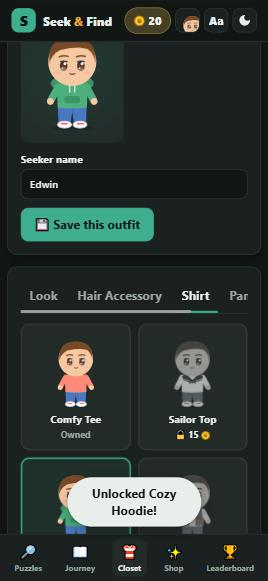
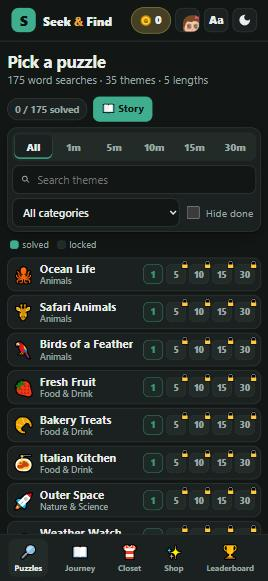
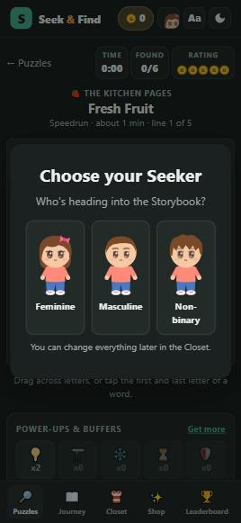
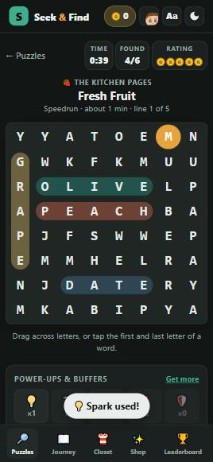
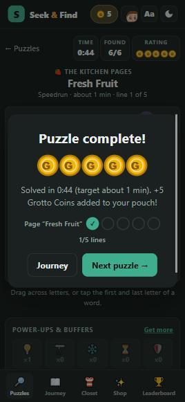
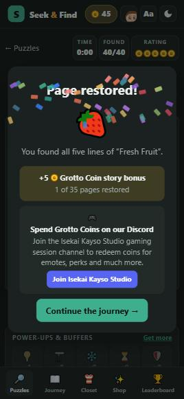
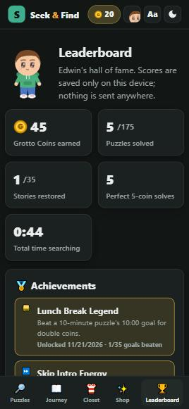

# Case Study: "Edwin": A Simulated Usability Run of *Seek & Find*

**Isekai Kayso Studio · Practice research run · November 21, 2026**

> **Read this first.** This is an **AI practice run**, not human-subjects research. "Edwin" is a **fictional composite persona**: any resemblance to a real person is coincidental. An AI tester played the live game as Edwin would, following a scripted scenario. No real person's data was collected, and nothing here is clinical evidence. *Seek & Find* is a game, **not a treatment** for substance use, loneliness or any mental-health condition.
>
> Its purpose is to stress-test the design against the studio's goals, and to prepare a real study with real participants.

---

## 1. Summary

| Design goal | Verdict | One-line reason |
|---|---|---|
| **Cozy** | ✅ Strong | Dark mode, soft colors, a chibi avatar and a warm, funny story. No ads, energy timers, purchases or sign-up wall. |
| **Chill** | ⚠️ Partial | Gentle hints and no fail state, but a ticking clock and a live coin rating that drops over time can feel like pressure. |
| **Self-paced** | ✅ Strong | The clock stops during story scenes, when paused and when the app is in the background. There are no streaks or daily deadlines. |
| **Immersive storytelling** | ⚠️ Partial | The comic scenes are charming, but the hero says "I'm **Seeker**" because the game never asks for a name, and story beats only come at each theme's start and finish. |
| **Candy Crush-style progression** | ✅ Mostly | Coins pop in one by one on "level complete", lengths unlock one after another, and a page progress strip fills up. The Journey is a grid rather than a winding map. |
| **Semi-RPG reward loop** | ✅ Strong | Earn coins → buy a hoodie → see it on your character. Achievements appear on the profile. |
| **Redeeming points on Discord** | ⚠️ Gap | The Discord link is offered at the right emotional moments, but coin balances live only on the player's device, so redemption is on the honor system. |
| **Supports the thesis** | ⚠️ Plausible, unproven | The design aligns with evidence on short-term mood, cravings and visual attention. Evidence for lasting "brain improvement" is weak, and the game is a solo experience while loneliness research points to *connection*. |

**The single most important fix:** on phones, the list of words to find sits *below the screen* (852 px down on an 812 px-tall phone). Players have to scroll away from the grid to remember what they're looking for.

---

## 2. The thesis, restated for research

**Original idea (studio):** productivity puzzles designed for relaxation, spelling, memory and attention to detail can improve brain function and help people overcome loneliness after recovering from addiction, emotional displacement, and insecure behavior: provoking the worst in others while calling *them* insecure and telling them to love themselves more.

**Working hypothesis used in this case study:**

> For adults in early recovery from a substance use disorder, a low-pressure, story-driven word-puzzle routine may (a) provide short-term relief from stress and cravings, (b) give steady practice in visual attention, word recognition and short-term memory, and (c) by pairing play with a self-compassionate narrative and an opt-in path to community, support a shift away from shame-driven, outwardly critical interactions toward self-compassion and connection.

The last clause names the pattern the studio described, of criticizing others as "insecure" while struggling inwardly. Clinicians often call this *externalizing shame*. Self-compassion research (Section 7) is the closest evidence base for it.

---

## 3. Persona: Edwin

| | |
|---|---|
| **Name / username** | Edwin |
| **Age** | 37 (born 1989, a millennial) |
| **Pronouns** | he/him |
| **Background** | Mexican-American; bilingual (English and Spanish), English-first online |
| **Location** | A mid-size city in the U.S. Midwest; apartment, lives alone with a rescue cat, Pixel |
| **Education** | Associate degree in IT |
| **Work** | Logistics coordinator at a distribution center, day shift (moved off nights during recovery) |
| **Household income** | About $48,000 a year |
| **Relationships** | Divorced in 2023; a close cousin; few local friends after leaving old drinking circles |
| **Recovery** | 14 months in early remission from alcohol use disorder. Goes to peer-support meetings twice a week, has a peer mentor, and sees an outpatient counselor monthly. |
| **Mental health** | Mild social anxiety. Loneliness peaks from **8 to 11 p.m.**, his highest-risk window. Inconsistent sleep. |
| **Interpersonal pattern** | When he feels ashamed or left out, he jabs at people online, calling them "insecure" and telling them to "love yourself, bro." Afterwards he feels worse. His counselor calls it externalizing shame. He wants to break the cycle. |
| **Devices** | Mid-range Android phone (6.1"), dark mode always on, text bumped up at night; an old laptop |
| **Gaming history** | Grew up on '90s and 2000s anime and handheld RPGs. Deleted a popular match-3 game: "the lives timer and the 'buy more moves' pop-ups felt like the slot-machine part of my brain." |
| **Online community** | In two Discord servers; mostly reads, rarely posts |
| **Goals** | A 20–30 minute wind-down ritual; a visible sense of progress; something low-stakes to talk about with people |
| **Frustrations** | Timers that feel like judgment, streak shaming, ads, pay-to-win, long sign-ups |
| **Success, in his words** | *"I put the phone down calmer than I picked it up."* |

**Scenario:** It's 9:40 p.m. on a weeknight. Edwin just got home from a meeting and the apartment is quiet. Instead of opening the group chat where he tends to pick fights, he opens *Seek & Find*.

---

## 4. Method

- **Type:** a simulated cognitive walkthrough with persona think-aloud, run by an AI tester on the **live public site** (kaysodesu.github.io/isekai-kayso-word-search).
- **Setup:** phone-sized screen (375 × 812 px, touch mode), dark mode, and a brand-new save with no prior progress.
- **Real interactions:** the first puzzle was played with real finger-style drags and taps: picking a body style, reading the story, finding words, using a hint, typing a name, and buying an outfit.
- **Sped-up portions (clearly marked):** to reach the story payoff and achievements within one session, the remaining four puzzles of the theme were solved automatically. Their times are **instant and not realistic**, so they are not used for any timing conclusions.
- **What was recorded:** task success, time to solve, coin rewards, on-screen positions (to check layout), errors, and screenshots.

### Tasks

| # | Task | Goal it tests |
|---|---|---|
| T1 | Open the site and get oriented | Cozy, chill |
| T2 | Tap a locked puzzle length | Progression clarity |
| T3 | Start a theme: choose a Seeker, read the prologue | Immersion, inclusivity |
| T4 | Solve the first 1-minute puzzle | Attention, flow, self-pacing |
| T5 | Use a hint when stuck | Chill, support |
| T6 | Finish the theme's five lengths and read the story payoff | Story, Candy Crush-style progression |
| T7 | Name the Seeker and buy an outfit | Semi-RPG loop |
| T8 | Check the profile, achievements and Discord link | Rewards, redemption, privacy |
| T9 | Turn on Large text and pause mid-puzzle | Accessibility, self-pacing |

---

## 5. Session log

| Time | What happened | Edwin's simulated reaction |
|---|---|---|
| 0:00 | Lands on "Pick a puzzle": 35 slim theme rows, no pop-ups. | *"Okay, this is quiet. I like quiet."* No "start here" cue, though. |
| 0:20 | Taps a padlocked length button. **Nothing happens.** | *"Is it broken?"* The explanation is a hover tooltip, and phones don't show those. |
| 0:35 | Taps **Fresh Fruit**. "Choose your Seeker" offers Feminine, Masculine and Non-binary; he picks Masculine. | *"Oh nice, I get to be me-ish."* |
| 0:40 | The five-panel prologue plays. The puzzle clock stays at **0:00** throughout. | Laughs at "better organization than your downloads folder." Then: *"Why does my guy say 'I'm Seeker'? I'm Edwin."* |
| 1:30 | The Fresh Fruit intro comic plays (Jumble: *"Ask my lawyer, the pineapple."*). | Smiles. Settles in. |
| 1:45 | Puzzle opens. The word list is **off-screen below the grid**, so he scrolls down to memorize six words, then back up. | *"Little memory game before the memory game."* Mildly annoying. |
| 2:05 | Drags OLIVE, then PEACH. Smooth colored highlights lock in. | *"That's satisfying."* |
| 2:19 | Finds DATE, then tries tap-first-letter, tap-last-letter on GRAPE. It works first try. | *"Good for one hand on the bus."* |
| 2:25 | Stuck on the vertical words. Uses a free **Spark**, which gently lights up an **M**. | *"A nudge, not a lecture."* |
| 2:29 | Finds MULBERRY and PAPAYA. **Solved in 0:44** → 5 Grotto Coins, which pop in one by one. "1/5 lines" of the page restored. | *"Okay, one more."* (the Candy Crush pull, but gentle) |
| (sped up) | The 5, 10, 15 and 30-minute Fresh Fruit puzzles are solved automatically. Time-goal bonuses and all three achievements trigger. | — |
| — | **Page restored!** Inky: *"The vendor threw in a free peach. We are thriving."* +5 story bonus, confetti, and a **Join Isekai Kayso Studio** Discord button. | *"Thriving. Sure. Tonight, yeah."* |
| — | In the Closet, types "Edwin" (*"Nice to meet you, Edwin!"*) and buys the **Cozy Hoodie** for 25 coins. His chibi now wears it. | *"Earned that hoodie."* This is the semi-RPG loop working. |
| — | Profile: "Edwin's hall of fame", stats, three achievements, the Discord invite, backup/restore, and a note that nothing leaves the device. | *"Good, nobody's tracking me."* |
| — | Turns on Large text: everything still fits. Pauses: the clock truly stops. | *"I can put it down whenever."* |

**Screens from the session**

| First impression | Choose your Seeker | A gentle hint | Level complete |
|---|---|---|---|
|  |  |  |  |

| Story payoff | Profile & achievements |
|---|---|
|  |  |

---

## 6. Findings

### What's working

- **S1 No manipulative design.** There are no ads, energy or lives systems, purchases, loot boxes or streaks. Zagal and colleagues (2013) describe these as "dark patterns" in game design, so their absence matters for a player whose recovery depends on not being pulled into compulsive loops.
- **S2 Truly self-paced.** The clock pauses during story scenes, on Pause, and when the app goes to the background.
- **S3 A satisfying core loop.** Drag-to-select and tap-tap both worked first try on touch, with clear highlights. The 1-minute puzzle took 0:44 of genuine play, close to its goal.
- **S4 Supportive help.** The free Spark felt like encouragement, not a penalty.
- **S5 A working earn → spend → wear loop.** Coins bought a hoodie, and the avatar changed right away. Achievements made progress visible.
- **S6 Inclusive and private.** Three body styles, adjustable text size, dark mode, reduce-motion, and a promise, kept in the code, that no data leaves the device.
- **S7 Humor that lands.** The millennial comedy ("third latte", "touch grass, maybe") fits the persona and lowers the emotional temperature.

### What needs work

| # | Finding | Severity | Goal affected |
|---|---|---|---|
| **F1** | **The word list is below the screen on phones** (852 px down on an 812 px-tall screen, 928 px with Large text). Players must scroll away from the grid to see their targets. | **High** | Chill, attention, accessibility |
| **F2** | **Coins can't be verified for Discord redemption.** Balances live only on the device, so a moderator has to take the player's word for it. | **High** (for redemption) | Semi-RPG redemption |
| **F3** | **Tapping a locked length does nothing on touch screens.** The explanation only appears as a desktop hover tooltip. | Medium | Progression clarity |
| **F4** | **The game never asks for the player's name.** The hero says "I'm Seeker" in the prologue; a name can only be set later, in the Closet. | Medium | Immersion |
| **F5** | **There's no relaxed mode.** The ticking clock and a coin rating that drops over time are always visible. | Medium | Chill |
| **F6** | **There's no gentle session pacing**, such as a check-in after 30–45 minutes or a "wind-down done" moment. | Medium | Recovery context (see Section 7: gaming disorder) |
| **F7** | **Length buttons are 28 × 28 px**, below the 44 × 44 px touch-target size recommended by Apple and Google. | Low–Medium | Accessibility |
| **F8** | **Story beats only come at a theme's start and finish.** The Journey is a grid of cards, not a winding Candy Crush-style map. | Low–Medium | Immersion, progression |
| **F9** | **English only**, while bilingual (Spanish) players are a likely audience. | Low | Inclusivity |
| **F10** | **The game is played alone**, and the Discord link is the only social bridge. Loneliness research points to connection, not just distraction. | Medium | Thesis fit |

---

## 7. Evaluating the thesis

| Part of the thesis | Evidence that supports it | Evidence that limits it | Verdict for this game |
|---|---|---|---|
| **Short-term relief from stress and cravings** | Casual puzzle play was linked to reduced tension and stress, with heart-rate and EEG changes consistent with relaxation (Russoniello et al., 2009). Three minutes of Tetris reduced cravings, including for alcohol and nicotine, by about 14 percentage points in everyday settings (Skorka-Brown et al., 2015). | The Russoniello study was small and funded by the game's developer. The Tetris sample was 31 undergraduates, not people with addiction, and one author said she wouldn't recommend Tetris as an addiction therapy. | **Plausible.** Short, absorbing puzzles fit this mechanism best. Worth measuring. |
| **"Improves brain function"** | People aged 50+ who did word puzzles more often scored better on 14 cognitive measures (Brooker et al., 2019, ~19,000 adults). Crosswords beat computer brain games over 78 weeks in mild cognitive impairment (Devanand et al., 2022). | Brooker's study shows association, not cause. A review of 130+ studies found brain training improves the trained task but has **inadequate evidence** of real-world transfer (Simons et al., 2016). Devanand had no untrained control group. | **Overstated as written.** Safer claim: *practice in visual attention and word recognition*. Word search trains **recognizing** spellings, not **producing** them. |
| **Memory** | — | Word search puts little demand on working memory by design. In this run, memory was exercised only by accident, because the word list was off-screen. | **Weak** unless memory is built in on purpose (for example an optional "memorize, then hide the list" mode). |
| **Overcoming loneliness in recovery** | Loneliness is a documented relapse risk, especially in opioid use disorder and for women in treatment, and patients name it as a major relapse trigger (see the PMC sources below). In UK records, 27% of patients with a substance use disorder had loneliness noted, linked to worse outcomes. | Even mindfulness-based relapse prevention did not reduce loneliness more than usual care, and researchers say loneliness needs *targeted* interventions. A solo game is not connection. | **Indirect at best.** The game can be a calm routine for the risky evening hours, and a bridge to community (Discord), not a cure. |
| **Well-being from gaming in general** | Logged play time in a cozy game (Animal Crossing) was weakly but positively linked to well-being (Johannes et al., 2021). Small qualitative studies find players use cozy games to cope through hard periods. | Follow-up work by the same group found little evidence that play time *causes* changes in well-being (2022). The cozy-game research is early and mostly qualitative. | **Supportive context, not proof.** |
| **Moving from shame-driven criticism toward self-love** | Higher self-compassion is linked to lower substance use disorder risk. Self-compassion programs improved self-compassion and depression in people with SUD (2025 meta-analysis). Labels shape judgment: clinicians judged a "substance abuser" more harshly than someone "with a substance use disorder" (Kelly & Westerhoff, 2010). | The trials are small and low-quality. And a game that *tells* players to "love yourself" could repeat the exact preachy pattern the persona uses on others. | **The most promising and least built part.** The story could *model* self-compassion through Inky and Jumble's arc (mistake → accountability → repair) rather than preach it. |
| **Risk to watch** | — | Gaming disorder affects a small minority (about 3–6% by recent estimates). For people in recovery, swapping one compulsive loop for another is a real concern. | **Design guardrails needed:** pacing check-ins (F6), no streak pressure, and no buying power with money. |

**Overall:** the thesis is *directionally reasonable* for **short-term calm, attention practice and routine-building**. It is **not supported as written** for "improving brain function" or "overcoming loneliness". The game's strongest contribution to recovery would come from (1) acting as a deliberate evening wind-down ritual, and (2) turning the Discord community into real, moderated connection.

Apps *can* earn a real role in recovery. The FDA cleared reSET in 2017 as the first prescription digital therapeutic for substance use disorder, based on a 399-patient trial (reference 12). That is the bar any treatment claim would have to meet. Until then, *Seek & Find* should describe itself as a **wellness and community tool**, not therapy.

---

## 8. Recommendations

### Quick wins (next update)
1. **Keep the word list visible on phones** (F1). Show the words as compact chips above or beside the grid, or as a collapsible strip that sticks to the screen.
2. **Explain locks on tap** (F3). A short message: *"Solve the 1-minute puzzle to unlock this."*
3. **Ask for a name in "Choose your Seeker"** (F4), so the prologue says *"I'm Edwin."*
4. **Bigger tap targets** (F7): length buttons at least 44 px.

### Next features
5. **Relaxed mode** (F5): hide the clock and rating. Base coins still count, with no double-coin bonus.
6. **Gentle pacing** (F6): an optional evening "wind-down" goal (for example 3 puzzles), and a kind check-in after 30–45 minutes. Never use streak shaming.
7. **Self-compassion beats in the story** (thesis): Inky responding warmly to a missed time goal; Jumble's apology arc as a model of accountability without self-attack.
8. **A saga-style Journey map and a mid-theme story line** (F8).
9. **Verified redemption** (F2): the set-aside Discord version already tracks coins on a server.
10. **Spanish language option** (F9).

### Research next steps (with real people)
- **Ethics first:** an ethics-board review, informed consent, and clear messaging that the game is not treatment. Show crisis resources, such as the SAMHSA National Helpline, **1-800-662-4357** (free, confidential, 24/7).
- **Design:** a 4-week within-person pilot with adults in recovery, recruited through peer-support partners, using evening play sessions.
- **Measures:** UCLA Loneliness Scale, Perceived Stress Scale, Self-Compassion Scale (short form), a 0–100 craving rating before and after play, and play time from an opt-in log on the player's device.
- **Partners:** a licensed counselor or recovery program to co-design the self-compassion story moments.

---

## 9. Limitations

- **Simulated, not real.** One fictional persona, played by an AI. Reactions are informed guesses, not data.
- **Sped-up play.** Four of the five puzzles were solved instantly, so the achievements and coin totals don't reflect realistic play.
- **One device type** (phone-sized screen) and one session.
- **Literature is summarized**, not systematically reviewed. Several key studies are small, correlational or industry-funded, as noted above.

---

## 10. References

1. Skorka-Brown, J., Andrade, J., Whalley, B., & May, J. (2015). Playing Tetris decreases drug and other cravings in real world settings. *Addictive Behaviors, 51*, 165–170. [Univ. of Plymouth record](https://pearl.plymouth.ac.uk/handle/10026.1/3458) · [ScienceDaily summary](https://sciencedaily.com/releases/2015/08/150813101535.htm)
2. Russoniello, C. V., et al. (2009). EEG, HRV and psychological correlates while playing Bejeweled II: a randomized controlled study. *Studies in Health Technology and Informatics, 144*, 189–192. [PubMed](https://pubmed.ncbi.nlm.nih.gov/19592761/)
3. Simons, D. J., et al. (2016). Do "brain-training" programs work? *Psychological Science in the Public Interest, 17*(3), 103–186. [APS summary](https://www.psychologicalscience.org/publications/brain-training.html)
4. Brooker, H., et al. (2019). An online investigation of the relationship between the frequency of word puzzle use and cognitive function in a large sample of older adults. *International Journal of Geriatric Psychiatry, 34*(7), 921–931. doi:10.1002/gps.5033 · [Univ. of Exeter release](https://news-archive.exeter.ac.uk/2019/may/title_716265_en.html)
5. Devanand, D. P., et al. (2022). Computerized games versus crosswords training in mild cognitive impairment. *NEJM Evidence*. [Columbia Psychiatry summary](https://columbiapsychiatry.org/news/crossword-puzzles-superior-computer-video-games-slowing-memory-loss-older-adults-mild-cognitive-impairment)
6. Johannes, N., Vuorre, M., & Przybylski, A. K. (2021). Video game play is positively correlated with well-being. *Royal Society Open Science, 8*, 202049. [PMC](https://pmc.ncbi.nlm.nih.gov/articles/PMC8074794) · Follow-up (2022): [Oxford Internet Institute](https://www.oii.ox.ac.uk/major-new-study-finds-little-evidence-for-causal-connection-between-well-being-and-video-game-playing/)
7. Loneliness and substance use: [Loneliness among adults receiving medication for opioid use disorder (PMC)](https://www.ncbi.nlm.nih.gov/pmc/articles/PMC9602554/) · [Loneliness, mindfulness and treatment retention (PMC)](https://www.ncbi.nlm.nih.gov/pmc/articles/PMC10454177/) · [Recognising loneliness in people with SUD (Maudsley BRC, 2025)](https://www.maudsleybrc.nihr.ac.uk/news/recognising-loneliness-in-people-with-substance-use-disorders/) · [VA trial NCT05338268](https://clinicaltrials.gov/study/NCT05338268)
8. Kelly, J. F., & Westerhoff, C. M. (2010). Does it matter how we refer to individuals with substance-related problems? A randomized study with two commonly used terms. *International Journal of Drug Policy, 21*, 202–207. [PubMed](https://pubmed.ncbi.nlm.nih.gov/20005692/) · [Recovery Research Institute summary](https://www.recoveryanswers.org/research-post/the-real-stigma-of-substance-use-disorders/)
9. Self-compassion and substance use: [Self-compassion and SUD risk (PubMed)](https://pubmed.ncbi.nlm.nih.gov/29241104/) · [Trauma-informed mindful recovery and self-compassion (PMC)](https://www.ncbi.nlm.nih.gov/pmc/articles/PMC9201725/) · [2025 systematic review and meta-analysis (PubMed)](https://pubmed.ncbi.nlm.nih.gov/40439418/)
10. Zagal, J. P., Björk, S., & Lewis, C. (2013). Dark patterns in the design of games. *Foundations of Digital Games 2013*. [Chalmers record](https://research.chalmers.se/en/publication/177148) · Critique: Deterding et al. (2020), [DiGRA](https://eprints.whiterose.ac.uk/156460/1)
11. World Health Organization. Gaming disorder (ICD-11). [WHO Q&A](https://www.who.int/news-room/q-a-detail/gaming-disorder) · Prevalence meta-analysis (2024): [PMC](https://www.ncbi.nlm.nih.gov/pmc/articles/PMC11203952/)
12. U.S. FDA clearance of reSET, the first prescription digital therapeutic for substance use disorder (2017). [Psychiatric News](https://psychnews.psychiatryonline.org/doi/10.1176/appi.pn.2017.pp10a3) · [IEEE Spectrum](https://spectrum.ieee.org/first-prescription-app-for-substance-abuse-approved-by-fda)
13. Cozy games and well-being (early research): [Oxford paper on coziness](https://ora.ox.ac.uk/objects/uuid:dd66abc4-10c5-4043-8898-ea55cc392703/files/r3197xp996) · [Utrecht thesis](https://studenttheses.uu.nl/handle/20.500.12932/47430) · [Erasmus thesis](https://thesis.eur.nl/pub/74942/) · [Leeds Beckett blog](https://www.leedsbeckett.ac.uk/blogs/school-of-humanities-and-social-sciences/2023/05/can-cosy-games-help-us-to-manage-anxiety/)

---

*If you or someone you know is struggling with substance use, the SAMHSA National Helpline is free, confidential and open 24/7: **1-800-662-4357**.*
